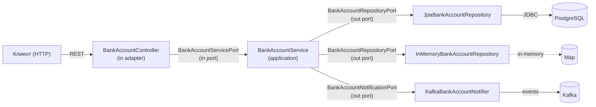

# Bank Account — Hexagonal Service 🏦

Гексагональное приложение (Ports & Adapters) для управления банковскими счетами.
Демонстрирует чистую архитектуру, DDD и событийную интеграцию через Kafka.

<p align="left">
  
  
  
  
  
</p>

## Зачем этот проект

Референсный пример того, как спроектировать бизнес-сервис с изолированным доменом
и взаимозаменяемыми адаптерами. Проект показывает:

- **Гексагональную архитектуру** — домен, порты и адаптеры разделены по пакетам;
- **DDD** — бизнес-правила живут в сущности `BankAccount`, а не в сервисе;
- **Инверсию зависимостей** — REST-контроллер зависит от порта, а не от реализации;
- **Событийную интеграцию** — доменные события публикуются в Kafka;
- **Несколько адаптеров за одним портом** — JPA и In-Memory репозитории.

## Архитектура

Зависимости направлены строго внутрь: `infrastructure → application → domain`.
Ядро (domain) не знает о Spring, JPA, Kafka и REST.



### Структура пакетов

```
src/main/java/ru/kuzmin/bankaccount/
├── BankAccountApplication.java
├── application/
│   └── service/BankAccountService.java            # use cases
├── domain/                                        # ядро
│   ├── event/                                     # доменные события
│   ├── models/
│   │   ├── entity/BankAccount.java                # сущность + бизнес-правила
│   │   └── dto/                                   # DTO
│   └── ports/
│       ├── in/BankAccountServicePort.java         # входной порт
│       └── out/                                   # выходные порты
│           ├── BankAccountRepositoryPort.java
│           └── BankAccountNotificationPort.java
├── infrastructure/
│   ├── adapters/
│   │   ├── in/api/BankAccountController.java      # REST-адаптер
│   │   └── out/
│   │       ├── kafka/KafkaBankAccountNotifier.java
│   │       └── persistence/                       # JPA + In-Memory
│   └── mappers/BankAccountMapper.java
└── resources/application.yaml
```

## Технологический стек

| Категория | Технологии |
|-----------|------------|
| Язык | Java 21 |
| Фреймворк | Spring Boot 3.5, Spring Web, Spring Data JPA, Spring Kafka |
| БД | PostgreSQL 17, HikariCP |
| Брокер | Apache Kafka 3.9 (KRaft) |
| Маппинг | MapStruct, Lombok |
| Сборка | Maven |
| Запуск | Docker Compose (PostgreSQL + Kafka + Kafka UI) |

## API

| Метод | Эндпоинт | Описание |
|-------|----------|----------|
| `POST` | `/accounts` | Создать счёт |
| `POST` | `/accounts/{id}/deposit` | Пополнить счёт |
| `POST` | `/accounts/{id}/withdraw` | Снять средства |
| `GET` | `/accounts/{id}/balance` | Проверить баланс |

### Примеры запросов

Создание счёта:

```bash
curl -X POST http://localhost:8080/accounts \
  -H "Content-Type: application/json" \
  -d '{"owner": "Иван Иванов", "initialBalance": 1000.00}'
# → возвращает id счёта, например 1
```

Пополнение:

```bash
curl -X POST http://localhost:8080/accounts/1/deposit \
  -H "Content-Type: application/json" \
  -d '{"amount": 500.00}'
```

Снятие:

```bash
curl -X POST http://localhost:8080/accounts/1/withdraw \
  -H "Content-Type: application/json" \
  -d '{"amount": 200.00}'
```

Проверка баланса:

```bash
curl http://localhost:8080/accounts/1/balance
```

## Запуск

Требования: Java 21, Maven, Docker.

```bash
# 1. Поднять PostgreSQL, Kafka (KRaft) и Kafka UI
docker-compose up -d

# 2. Запустить приложение
mvn spring-boot:run
```

Kafka UI доступен по адресу `http://localhost:8888` — в нём можно посмотреть события
в топике `bank-account-events` после операций со счётом.

## Архитектурные решения (ADR)

Ключевые решения с обоснованием и trade-off'ами — в [`docs/adr/`](docs/adr/README.md):

- [0001 — Гексагональная архитектура (Ports & Adapters)](docs/adr/0001-hexagonal-architecture.md)
- [0002 — Персистентность: Spring Data JPA + PostgreSQL](docs/adr/0002-persistence-jpa-postgresql.md)
- [0003 — Публикация доменных событий в Kafka](docs/adr/0003-domain-events-kafka.md)
- [0004 — Transactional Outbox для надёжной публикации событий](docs/adr/0004-transactional-outbox.md)

## Текущее состояние и Roadmap

| Статус | Пункт |
|--------|-------|
| ✅ | Гексагональная структура, порты и адаптеры |
| ✅ | Бизнес-правила в сущности `BankAccount` |
| ✅ | Доменные события + публикация в Kafka |
| ✅ | REST API (create / deposit / withdraw / balance) |
| ✅ | Docker Compose: PostgreSQL + Kafka + Kafka UI |
| 🔜 | Отделение доменной модели от JPA (persistence-сущность в infrastructure) |
| 🔜 | Доменные исключения + `@ControllerAdvice` (404/400 вместо 500) |
| 🔜 | Optimistic locking (`@Version`) против гонок |
| 🔜 | Transactional Outbox (см. ADR-0004) |
| 🔜 | Юнит/интеграционные тесты + ArchUnit-тест границ |
| 🔜 | CI (GitHub Actions) |

## Лицензия

[MIT](LICENSE)
