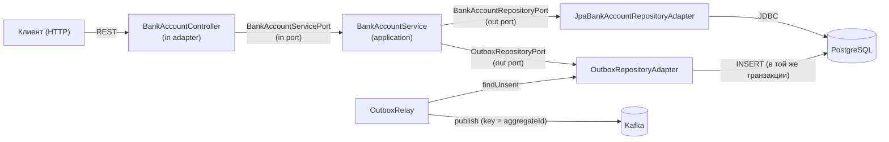

# Bank Account — Hexagonal Service 🏦

Гексагональное приложение (Ports & Adapters) для управления банковскими счетами.
Демонстрирует чистую архитектуру, DDD, надёжную событийную интеграцию и тестируемость.

<p align="left">
  
  
  
  
  
</p>

## Зачем этот проект

Референсный пример того, как спроектировать бизнес-сервис с изолированным доменом,
надёжной публикацией событий и взаимозаменяемыми адаптерами. Проект показывает:

- **Гексагональную архитектуру** — домен, порты и адаптеры разделены по пакетам;
- **DDD** — бизнес-правила живут в агрегате `BankAccount`, а не в сервисе;
- **Инверсию зависимостей** — REST-контроллер зависит от порта, а не от реализации;
- **Transactional Outbox** — событие сохраняется в одной транзакции с изменением агрегата, публикуется relay'ем;
- **Оптимистичную блокировку** (`@Version`) против гонок;
- **Доменные исключения** с корректным маппингом в HTTP-статусы;
- **Тесты**: юнит, сервисные, контроллерные, ArchUnit (границы) и интеграционные (Testcontainers).

## Архитектура

Зависимости направлены строго внутрь: `infrastructure → application → domain`.
Ядро (domain) не знает о Spring, JPA, Kafka и REST.



### Структура пакетов

```
src/main/java/ru/kuzmin/bankaccount/
├── BankAccountApplication.java
├── application/
│   ├── mappers/BankAccountMapper.java            # маппер домен → DTO
│   └── service/BankAccountService.java           # use cases
├── domain/                                       # ядро (без фреймворков)
│   ├── event/                                    # доменные события + OutboxRecord
│   ├── exception/                                # доменные исключения
│   ├── models/
│   │   ├── entity/BankAccount.java               # агрегат + бизнес-правила
│   │   └── dto/                                  # DTO
│   └── ports/
│       ├── in/BankAccountServicePort.java        # входной порт
│       └── out/                                  # выходные порты
│           ├── BankAccountRepositoryPort.java
│           └── OutboxRepositoryPort.java
├── infrastructure/
│   └── adapters/
│       ├── in/api/
│       │   ├── BankAccountController.java        # REST-адаптер
│       │   └── GlobalExceptionHandler.java       # маппинг ошибок → HTTP
│       └── out/
│           ├── persistence/                      # JPA-сущности, адаптеры, outbox
│           └── relay/OutboxRelay.java            # публикация событий в Kafka
└── resources/application.yaml
```

## Технологический стек

| Категория | Технологии |
|-----------|------------|
| Язык | Java 21 |
| Фреймворк | Spring Boot 3.5, Spring Web, Spring Data JPA, Spring Kafka |
| БД | PostgreSQL 17, HikariCP |
| Брокер | Apache Kafka 3.9 (KRaft) |
| Маппинг | MapStruct, Lombok |
| Тесты | JUnit 5, Mockito, AssertJ, ArchUnit, Testcontainers |
| Сборка | Maven |
| Запуск | Docker Compose (PostgreSQL + Kafka + Kafka UI) |

## API

| Метод | Эндпоинт | Описание |
|-------|----------|----------|
| `POST` | `/accounts` | Создать счёт |
| `POST` | `/accounts/{id}/deposit` | Пополнить счёт |
| `POST` | `/accounts/{id}/withdraw` | Снять средства |
| `GET` | `/accounts/{id}/balance` | Проверить баланс |

Ошибки возвращаются в едином формате `{timestamp, status, error, message}`:
`400` (неверная сумма), `404` (счёт не найден), `409` (недостаточно средств / конкурентное изменение).

### Примеры запросов

```bash
# Создание счёта
curl -X POST http://localhost:8080/accounts \
  -H "Content-Type: application/json" \
  -d '{"owner": "Иван Иванов", "initialBalance": 1000.00}'

# Пополнение
curl -X POST http://localhost:8080/accounts/1/deposit \
  -H "Content-Type: application/json" \
  -d '{"amount": 500.00}'

# Снятие
curl -X POST http://localhost:8080/accounts/1/withdraw \
  -H "Content-Type: application/json" \
  -d '{"amount": 200.00}'

# Баланс
curl http://localhost:8080/accounts/1/balance
```

## Запуск

Требования: Java 21, Maven, Docker.

```bash
docker-compose up -d      # PostgreSQL, Kafka (KRaft), Kafka UI
mvn spring-boot:run       # приложение
```

Kafka UI — `http://localhost:8888`, события публикуются в топик `bank-account-events`.

## Тестирование

```bash
mvn test
```

| Слой | Что проверяется |
|------|-----------------|
| Домен | Инварианты `deposit`/`withdraw` (юнит-тесты) |
| Сервис | Сценарии с замоканными портами (Mockito) |
| Контроллер | `@WebMvcTest` + маппинг ошибок в HTTP-статусы |
| Архитектура | ArchUnit: домен не зависит от Spring/JPA/Kafka, application не зависит от infrastructure |
| Интеграция | Testcontainers (PostgreSQL + Kafka): событие доходит до Kafka end-to-end (требует Docker, без него автоскип) |

## Архитектурные решения (ADR)

Ключевые решения с обоснованием и trade-off'ами — в [`docs/adr/`](docs/adr/README.md):

- [0001 — Гексагональная архитектура (Ports & Adapters)](docs/adr/0001-hexagonal-architecture.md)
- [0002 — Персистентность: Spring Data JPA + PostgreSQL](docs/adr/0002-persistence-jpa-postgresql.md)
- [0003 — Публикация доменных событий в Kafka](docs/adr/0003-domain-events-kafka.md)
- [0004 — Transactional Outbox для надёжной публикации событий](docs/adr/0004-transactional-outbox.md)

## Текущее состояние и Roadmap

| Статус | Пункт |
|--------|-------|
| ✅ | Гексагональная структура, порты и адаптеры |
| ✅ | Отделение доменной модели от JPA (persistence-сущность в infrastructure) |
| ✅ | Доменные события + Transactional Outbox + relay |
| ✅ | Доменные исключения + `@ControllerAdvice` (400/404/409) |
| ✅ | Optimistic locking (`@Version`) |
| ✅ | REST API (create / deposit / withdraw / balance) |
| ✅ | Юнит / сервисные / контроллерные / ArchUnit / интеграционные тесты |
| 🔜 | CI (GitHub Actions): build + test |
| 🔜 | Миграции БД (Flyway/Liquibase) вместо `ddl-auto: update` |

## Лицензия

[MIT](LICENSE)
